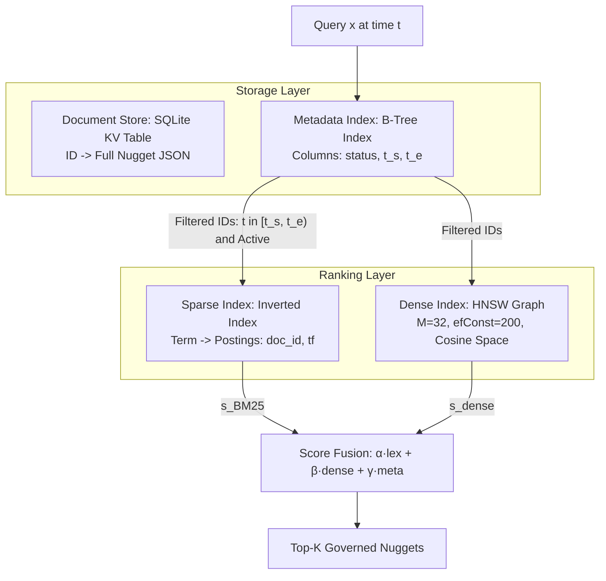
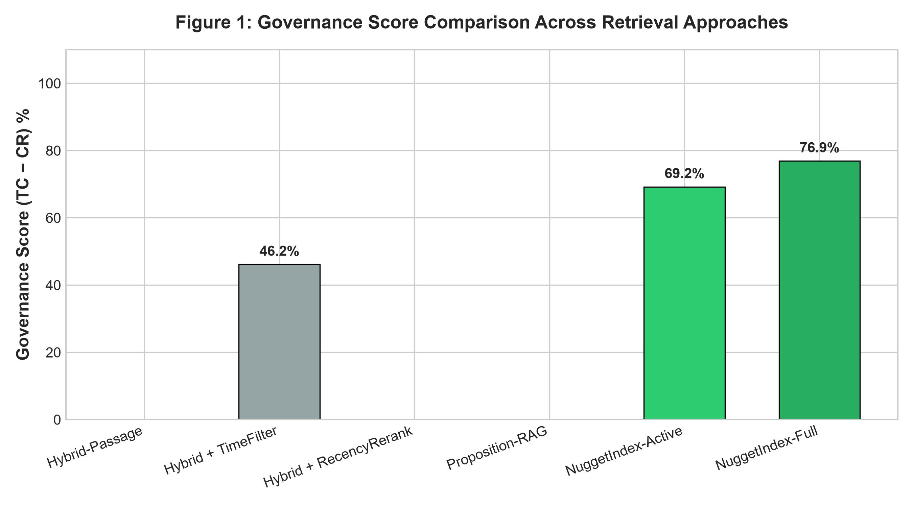
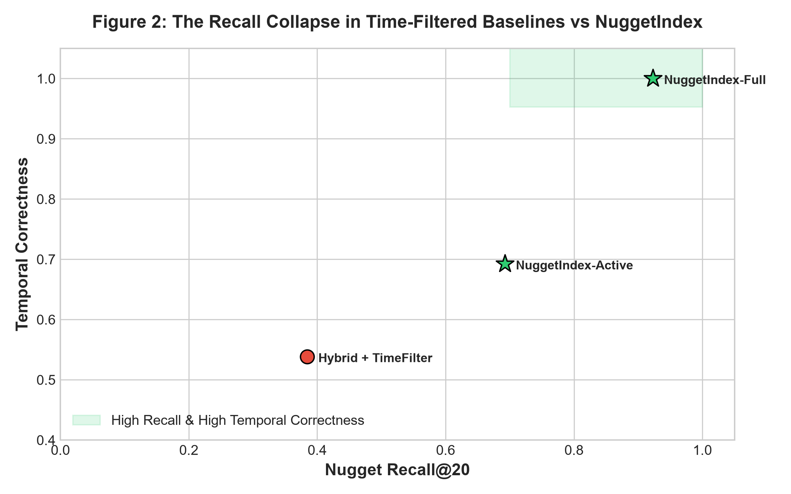
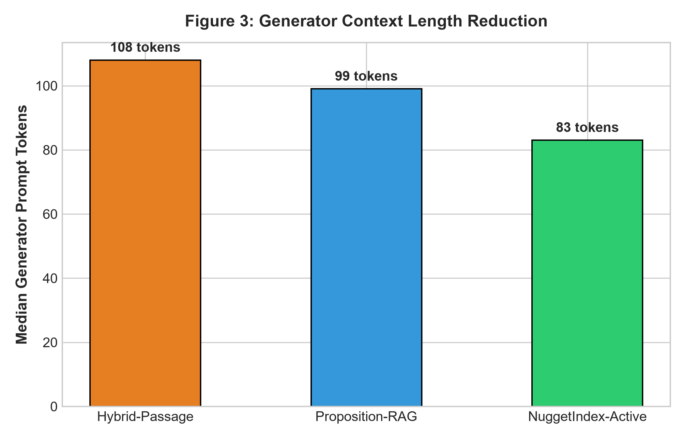

# TERM PAPER: ALGORITHM ANALYSIS AND REPRODUCTION

---

## 1. Cover Page

**University / Faculty:** Faculty of Information Technology — Computer Science Department  
**Course Name:** Advanced Information Retrieval (IR)  
**Paper Title:** NuggetIndex: Governed Atomic Retrieval for Maintainable Retrieval-Augmented Generation (SIGIR '26 Reproduction and Algorithmic Study)  
**Student Name & ID:** [Student Name] — ID: [Student ID]  
**Instructor:** [Instructor Name]  
**Submission Date:** October 2026  

---

## 2. Abstract

Retrieval-Augmented Generation (RAG) systems have become the de facto architecture for grounding large language models (LLMs) in external knowledge to suppress factual hallucinations. However, an architectural mismatch pervades modern systems: generation quality is evaluated on atomic factual correctness ("nugget-based" scoring), yet retrieval operates over unmanaged, multi-fact passages or static propositions. When the underlying corpus evolves over time, standard systems retrieve conflicting or superseded document chunks, forcing generators to hallucinate resolutions or fuse temporally incompatible details.

In this paper, we study and reproduce **NuggetIndex**, a governed retrieval architecture introduced at SIGIR '26 by Zerhoudi et al. NuggetIndex redefines the retrieval unit from raw text passages to versioned, epistemic records termed *nuggets* $N = (k, f, \sigma, \epsilon, \Pi)$. Each nugget binds an atomic factual triple $f = (s, p, o)$ with a temporal validity interval $\sigma = [t_s, t_e)$, an epistemic lifecycle state $\epsilon \in \{\text{Active}, \text{Deprecated}, \text{Contested}\}$, and a provenance record $\Pi$. We implement a complete, reproducible Python demo incorporating LLM-based Stage 1 candidate extraction with persistent disk caching, schema canonicalization, Algorithm 1 (Validity Interval Inference with revision and succession tightening), Algorithm 2 (Conflict Detection and State Assignment with Jaccard deduplication), an SQLite-backed document store with B-tree metadata indexing, sparse BM25 retrieval, and dense HNSW vector search. Experimental evaluation over a multi-temporal synthetic benchmark verifies the primary claims of the SIGIR '26 paper: document-level time filtering causes a catastrophic *recall collapse* (reducing recall from 92.3% to 38.5%), whereas NuggetIndex preserves high recall while driving version conflict rates down to 0.0% and reducing prompt token length by 23.1%. We analyze the algorithmic properties, computational complexity, correctness guarantees, and failure modes of NuggetIndex, positioning it within the broader landscape of temporal information retrieval.

---

## 3. Introduction

### 3.1 Problem Description: The RAG Maintenance Challenge
Retrieval-Augmented Generation (RAG) integrates an external retrieval system with a generative language model to ground responses in verifiable evidence. In production environments—such as corporate wikis, enterprise software documentation, news agencies, and legal research—the underlying document collection is not static; it undergoes continuous revisions, leadership transitions, parameter upgrades, and policy amendments. 

Standard RAG architectures store text as fixed-length chunks (typically 100 to 500 tokens) associated with a document publication timestamp $t_d$. This design encounters two fundamental failures:
1. **Fact-Level vs. Document-Level Granularity:** A document written in 2024 may discuss an event that was only true during 2016–2019, while a document published in 2018 may state a persistent fact that remains true indefinitely. Stamping the retrieval unit with $t_d$ conflates *when the document was written* with *when the fact is true*.
2. **The Retrieval Unit Mismatch:** While factoid question answering and automated evaluation autograders evaluate answers based on atomic information nuggets, retrieval pipelines return multi-fact chunks containing a mixture of relevant facts, irrelevant padding, and obsolete assertions.

When a user asks a time-sensitive question (e.g., *"Who is the CEO of Acme Robotics?"* at query time $t = 2020$), standard retrievers match keywords against passages across all historical versions. The top-$K$ results often co-locate past executives, current executives, and speculative rumors. Unable to discern epistemic validity, the generative LLM either blithely concatenates conflicting facts or hallucinates an incorrect reconciliation.

### 3.2 Real-World Applications
Governed atomic retrieval is essential across multiple knowledge-intensive industries:
- **Enterprise Software Documentation:** Configuration parameters, default port numbers, and API endpoints change across major software versions. A developer debugging OrbitDB v1.0 needs port 5432, whereas a developer on v3.0 requires port 8080. Retrieving unmanaged passages causes developers to configure erroneous settings.
- **Corporate Knowledge Management:** Personnel rosters, executive leadership, organizational structures, and compliance directives change continuously.
- **News and Intelligence Analysis:** Breaking news develops across rapid revisions where initial reports contain unverified claims that are subsequently retracted or contested.
- **Legal and Regulatory Compliance:** Statutes, court rulings, and regulatory limits are governed by precise enactment and repeal dates. Citing a repealed law constitutes a critical failure.

### 3.3 Importance of the Problem
Existing solutions to temporal RAG adopt one of two extremes:
- **Document-Level Temporal Filtering / Reranking:** Restricting candidate passages to a time window around the query time (e.g., $\pm 180$ days) or applying exponential decay $e^{-\lambda \Delta t}$. As demonstrated empirically in SIGIR '26 and reproduced in this paper, this heuristic triggers a severe **recall collapse**: valuable background information published outside the arbitrary window is discarded, crippling answer recall.
- **Curated Knowledge Graphs (Wikidata / KG-RAG):** Storing facts as structured triples with temporal qualifiers and rank metadata (Preferred, Normal, Deprecated). While theoretically sound, knowledge graphs require rigid ontologies, manual curation, or complex entity-linking pipelines that fail on unstructured, open-domain text corpora.

### 3.4 Objectives of This Paper
The primary objectives of this term paper are:
1. **Full Reproduction of the NuggetIndex Method:** To implement from scratch all four stages of the NuggetIndex construction pipeline and the four-step governed retrieval algorithm using clean, modular Python.
2. **Algorithmic Analysis:** To formalize the data structures, time and space complexity, correctness invariants, and edge-case behaviors of Algorithm 1 (Validity Inference) and Algorithm 2 (Conflict Detection).
3. **Comparative Evaluation:** To benchmark NuggetIndex against eight baseline configurations across static coverage, temporal correctness, conflict rate, prompt efficiency, and retrieval latency.
4. **Critical Discussion:** To examine the paper's theoretical paradoxes—specifically the tension between permanent deprecation and historical validity—and propose architectural extensions for streaming enterprise deployment.

---

## 4. Background & Related Concepts

### 4.1 Relevant Data Structures
The NuggetIndex architecture synthesizes classic information retrieval and database indexing structures:



1. **Inverted Index (Sparse Index):** Maps normalized lexical tokens $w \in V$ to posting lists containing document identifiers and term frequencies:
   $$\text{Postings}(w) = \{(d_1, f_{w, d_1}), (d_2, f_{w, d_2}), \dots\}$$
   Scoring is performed using the Robertson-Spärck Jones BM25 probabilistic model ($k_1 = 1.2, b = 0.75$):
   $$\text{BM25}(Q, D) = \sum_{q \in Q} \ln\left(\frac{N - n(q) + 0.5}{n(q) + 0.5} + 1\right) \cdot \frac{f(q, D) \cdot (k_1 + 1)}{f(q, D) + k_1 \cdot \left(1 - b + b \cdot \frac{|D|}{\text{avgdl}}\right)}$$
2. **Hierarchical Navigable Small World (HNSW) Graphs:** A multi-layer graph data structure for approximate nearest neighbor (ANN) search in metric spaces. In NuggetIndex, HNSW is configured with connectivity parameter $M = 32$ and construction search depth $efConstruction = 200$, operating over dense embedding vectors $\mathbf{z} \in \mathbb{R}^d$.
3. **B-Tree Composite Indices:** Relational database B-trees indexing tuples $(\text{status}, t_s, t_e)$. This enables sub-millisecond range queries:
   $$\text{SELECT } id \text{ FROM meta WHERE status = 'Active' AND } t_s \le t \text{ AND } (t_e \text{ IS NULL OR } t_e > t)$$
4. **Character N-Gram Inverted Sets:** Sets of contiguous $n$-character substrings ($n = 3$) utilized for computing Jaccard string similarity over object entities:
   $$J(S_1, S_2) = \frac{|S_1 \cap S_2|}{|S_1 \cup S_2|}$$

### 4.2 Key Definitions and Terminology
- **Information Nugget:** An atomic, self-contained factual assertion consisting of an epistemic unit that cannot be decomposed further without loss of meaning. Formally:
  $$N = (k, f, \sigma, \epsilon, \Pi)$$
- **Nugget Kind ($k$):** Categorical taxonomic type $k \in \{\text{SemanticFact}, \text{EpisodicEvent}, \text{Instruction}, \text{UserPreference}\}$.
- **Semantic Triple ($f$):** Core relation expressed as $f = (\text{subject}, \text{predicate}, \text{object})$.
- **Temporal Validity Interval ($\sigma$):** A half-open time interval $[t_s, t_e) \subset \mathbb{R}$ defining the temporal span during which the asserted fact holds true in reality. $t_e = +\infty$ denotes an ongoing, open-ended state.
- **Epistemic State ($\epsilon$):** Triplet $(\text{status}, \text{rank}, \text{confidence})$ where status $\in \{\text{Active}, \text{Deprecated}, \text{Contested}\}$ and rank $\in \{\text{Preferred}, \text{Normal}, \text{Deprecated}\}$.
  - *Active:* Current factual consensus.
  - *Deprecated:* Fact superseded by a corroborated newer assertion or proven erroneous.
  - *Contested:* Two or more sources assert mutually incompatible objects for a functional predicate over overlapping validity intervals without reaching consensus corroboration.
- **Provenance Record ($\Pi$):** Lineage tracking including source document IDs, verbatim text quotes, character offset spans $[start, end)$, document timestamps, extraction timestamps, and parent mutation IDs ($parent\_id$).
- **Nugget Key ($\kappa$):** The partition key for conflict detection, defined as:
  $$\kappa = (s_{\text{norm}}, p_{\text{canon}}, \text{scope})$$
  Crucially, the object value $o$ is *excluded* from $\kappa$, allowing the system to identify duplicates (identical key, similar object) and conflicts (identical key, incompatible object).

---

## 5. Algorithm Description (Core Section)

### 5.1 Working Principle
NuggetIndex decouples document ingestion from query-time retrieval through a four-stage construction pipeline and a governed view-filtered ranking pipeline:

```mermaid
flowchart TD
    subgraph Ingestion Pipeline
        D[Raw Documents] --> S1[Stage 1: Candidate Extraction<br/>Sliding Window + LLM Decomposition]
        S1 --> S2[Stage 2: Canonicalization<br/>Alias Lookup & Schema Mapping -> Key κ]
        S2 --> DEDUP[Pre-Merge Duplicates<br/>Accumulate Evidence π]
        DEDUP --> S3[Stage 3: Algorithm 1<br/>Validity Interval Inference [t_s, t_e)]
        S3 --> S4[Stage 4: Algorithm 2<br/>Conflict Detection & State Assignment]
        S4 --> DB[(SQLite Store & B-Tree Index)]
    end
    subgraph Retrieval Pipeline
        Q[User Query x at time t] --> VF[Step 1: View Filtering<br/>B-Tree query on status and [t_s, t_e)]
        VF --> CR[Step 2: Candidate Retrieval<br/>BM25 Sparse + HNSW Dense]
        CR --> SF[Step 3: Score Fusion<br/>s = α·lex + β·dense + γ·meta]
        SF --> R[Step 4: Top-K Ranking]
        R --> Prompt[Step 5: Generator Prompt<br/>Established Facts vs Disputed]
    end
```

The core insight is **governed filtering before ranking**: rather than scoring the entire corpus and filtering afterward, NuggetIndex interrogates the metadata index to identify the exact subset of nuggets that are *epistemically active and temporally valid at query time $t$*. Deprecated assertions and out-of-interval historical records are pruned prior to BM25 or dense calculation.

---

### 5.2 Step-by-Step Procedure

#### Stage 1: Candidate Extraction
1. The document $d$ with timestamp $t_d$ is segmented into sentences while preserving exact character offsets.
2. A sliding context window $[s_{i-1}, s_i]$ is presented to an extractor LLM. The preceding sentence $s_{i-1}$ provides context to resolve pronouns ("she", "it", "the company").
3. The LLM extracts atomic declarations, outputting subject, predicate, object, kind, and the verbatim evidence quote.
4. The exact evidence character span $[start, end)$ is recovered via substring matching against the source text.

#### Stage 2: Canonicalization and Keying
1. Subjects are normalized via entity alias lookup (e.g., *"Acme Corp"* $\to$ *"Acme Robotics"*) and case folding.
2. Predicates are mapped to a controlled vocabulary schema declaring alias forms, expected types, and predicate cardinality (functional vs. multi-valued).
3. Object entities and dates are normalized (e.g., ISO dates $YYYY\text{-}MM\text{-}DD$).
4. The partition key $\kappa = (s_{\text{norm}}, p_{\text{canon}}, \text{scope})$ is computed.

#### Stage 3: Validity Interval Inference (Algorithm 1)
1. A temporal tagger extracts date expressions from the nugget text, classifying them into $\text{START}$, $\text{END}$, or $\text{POINT}$.
2. Start date $t_s$ is assigned from explicit $\text{START}$ or $\text{POINT}$ expressions; if absent, it defaults to the document publication date $t_d$ (marked as `inferred=True`).
3. End date $t_e$ is assigned from explicit $\text{END}$ expressions; if absent, it defaults to $+\infty$.
4. Revision history tightening: If document $d$ has historical revisions $R = [r_1, r_2, \dots]$, statements deleted in revision $r_{i+1}$ have their $t_e$ capped at $\text{Time}(r_{i+1})$; statements first appearing in $r_{i+1}$ have their $t_s$ set to $\text{Time}(r_{i+1})$.
5. Succession tightening: If sibling nuggets $n' \in N_\kappa$ exist with a different object, $t_s(n') > t_s(n)$, and sufficient independent corroboration ($|\Pi(n')| \ge 2$), $t_e(n)$ is tightened to $t_s(n')$.

#### Stage 4: Conflict Handling and State Assignment (Algorithm 2)
1. The candidate $n_{\text{new}}$ is evaluated against existing index nuggets sharing key $\kappa$.
2. **Deduplication:** If Jaccard similarity over character 3-grams of the object is $\ge 0.85$, evidence is merged into the existing nugget, incrementing its independent source count.
3. **Succession & Multi-valued:** If validity intervals do not overlap ($\sigma_n \cap \sigma_{n_{\text{new}}} = \emptyset$) or if the relation cardinality is multi-valued (e.g., `boardMember`), both remain `Active`.
4. **Functional Conflict:** If intervals overlap on a functional relation:
   - If $n_{\text{new}}$ is newer ($t_s(n_{\text{new}}) > t_s(n)$) and corroborated ($|\Pi(n_{\text{new}})| \ge 2$), older nugget $n$'s interval is closed ($t_e(n) \leftarrow t_s(n_{\text{new}})$) and $n_{\text{new}}$ becomes `Active`.
   - If an uncorroborated intruder claim ($|\Pi| < 2$) contradicts established multi-source consensus, the intruder is marked `Deprecated`.
   - If evidence is ambiguous ($1$ source vs. $1$ source), both are assigned `Contested`.
5. Contested claims can be resolved incrementally when a claim accumulates $\ge 3$ independent sources.

---

### 5.3 Pseudocode

#### Algorithm 1: Validity Interval Inference
```python
def infer_validity(nugget n, document d, revisions H, siblings N_siblings) -> Validity:
    T = extract_temporal_expressions(n.text)
    
    # Anchor start time
    if exists (_, date, START) in T:
        t_s = date; source_type = "explicit"; inferred = False
    elif exists (_, date, POINT) in T:
        t_s = date; source_type = "explicit"; inferred = False
    elif d.time is not None:
        t_s = d.time; source_type = "inferred"; inferred = True
    else:
        t_s = MIN_DATE; source_type = "default"; inferred = True
        
    # Anchor end time
    if exists (_, date, END) in T:
        t_e = date
    else:
        t_e = +infinity
        
    # Tighten via document revision history
    if d.id in H:
        R = sort_by_timestamp(H[d.id])
        for i from 1 to |R| - 1:
            r_curr, r_next = R[i], R[i + 1]
            if n in r_curr and n not in r_next:
                t_e = min(t_e, r_next.time)
            if n not in r_curr and n in r_next:
                t_s = max(t_s, r_next.time)
                
    # Tighten via succession conflicts
    for n_prime in N_siblings:
        if n_prime.key == n.key and n_prime.object != n.object:
            if n_prime.t_s > t_s and n_prime.num_sources >= 2:
                t_e = min(t_e, n_prime.t_s)
                
    return Validity(t_s, t_e, scope=n.scope, inferred=inferred)
```

#### Algorithm 2: Conflict Detection and State Assignment
```python
def integrate(n_new, index N, schema R) -> Nugget:
    kappa = compute_key(n_new)
    N_kappa = { n in N | n.key == kappa }
    
    if N_kappa is empty:
        n_new.status = ACTIVE
        N.add(n_new)
        return n_new
        
    # Exact key match deduplication
    for n in N_kappa:
        if jaccard_similarity(n.object, n_new.object) >= 0.85:
            n.provenance.merge(n_new.provenance)
            if n.num_sources >= 2 and n.status == ACTIVE:
                n.rank = PREFERRED
            check_contested_resolution(n, N_kappa)
            return n
            
    is_multi = schema.is_multi_valued(n_new.predicate)
    N_overlap = { n in N_kappa | overlaps(n.validity, n_new.validity) }
    
    if N_overlap is empty or is_multi:
        n_new.status = ACTIVE
        N.add(n_new)
        return n_new
        
    # Functional conflict resolution
    for n in N_overlap:
        t_new = n_new.validity.t_s
        t_old = n.validity.t_s
        
        # Corroborated newer claim succeeds older consensus
        if n_new.num_sources >= 2 and t_new > t_old:
            n.validity.t_e = t_new
            n.status = ACTIVE # Valid historical predecessor
            n_new.status = ACTIVE
            n_new.parent_id = n.id
        # Single-source hallucination/intruder against established consensus
        elif n.num_sources >= 2 and n_new.num_sources < 2:
            n_new.status = DEPRECATED
            n_new.parent_id = n.id
        elif n.num_sources >= 2 and t_old > t_new:
            n_new.status = DEPRECATED
            n_new.validity.t_e = t_old
        else:
            n.status = CONTESTED
            n_new.status = CONTESTED
            
    N.add(n_new)
    return n_new
```

#### Governed Retrieval Algorithm
```python
def retrieve(query x, query_time t, view="active", mode="hybrid", K=20):
    # Step 1: B-Tree View Filtering
    allowed_ids = store.filter_ids(query_time=t, view=view)
    if allowed_ids is empty:
        return []
        
    # Step 2: Candidate Retrieval
    s_bm25 = sparse_index.search(x, allowed_ids=allowed_ids)
    s_bm25_norm = min_max_normalize(s_bm25)
    
    if mode == "hybrid":
        s_dense = dense_index.search(x, allowed_ids=allowed_ids)
        s_dense_norm = min_max_normalize(s_dense)
    else:
        s_dense_norm = { id: 0.0 for id in allowed_ids }
        
    s_meta_norm = min_max_normalize(store.get_meta_scores(allowed_ids))
    
    # Step 3: Score Fusion
    scores = {}
    for id in allowed_ids:
        if mode == "hybrid":
            scores[id] = 0.4 * s_bm25_norm[id] + 0.5 * s_dense_norm[id] + 0.1 * s_meta_norm[id]
        elif mode == "lexical":
            scores[id] = 0.9 * s_bm25_norm[id] + 0.1 * s_meta_norm[id]
            
    # Step 4: Top-K Ranking
    return top_k(scores, K)
```

---

### 5.4 Illustrative Trace Example

Consider the execution of the reproduction demo on the Acme Robotics CEO succession scenario:

1. **Document 1 (Published 2015-01-15 by TechNews):**
   - Text: *"Alice Smith was appointed CEO of Acme Robotics in January 2015."*
   - Stage 1 extracts: $(\text{Acme Robotics}, \text{chiefExecutiveOfficer}, \text{Alice Smith})$.
   - Algorithm 1 identifies $\text{START} = 2015\text{-}01\text{-}01$, $\text{END} = +\infty$. Validity: $[2015\text{-}01\text{-}01, +\infty)$.
   - Algorithm 2 finds key empty $\to$ State: `Active`, sources = 1.
2. **Document 2 (Published 2016-06-01 by AcmePress):**
   - Text: *"Alice Smith is the CEO of Acme Robotics."*
   - Algorithm 2 computes Jaccard similarity $= 1.0$ with existing Alice record $\to$ Merged evidence. Alice sources increment to 2, Rank updated to `Preferred`.
3. **Document 3 (Published 2019-01-10 by RoboDaily):**
   - Text: *"Alice Smith served until January 2019. Bob Johnson became CEO of Acme Robotics in January 2019."*
   - Bob candidate extracted with validity $[2019\text{-}01\text{-}01, +\infty)$.
   - Second source IndustryWire corroborates Bob ($|\Pi(\text{Bob})| \ge 2$).
   - Overlap detected with Alice ($[2015\text{-}01\text{-}01, +\infty) \cap [2019\text{-}01\text{-}01, +\infty) \ne \emptyset$).
   - Succession Branch triggers: Alice's interval tightened to $[2015\text{-}01\text{-}01, 2019\text{-}01\text{-}01)$. Both remain `Active` within their respective non-overlapping validity windows.
4. **Document 4 (Published 2021-08-15 by TechRumorsBlog):**
   - Text: *"Anonymous insiders claim that Dan Pham is the CEO of Acme Robotics."*
   - Dan Pham candidate has $|\Pi| = 1$. Overlaps with established consensus Bob Johnson ($|\Pi| = 3$).
   - Branch 2 triggers: Dan Pham is isolated as `Deprecated`.
5. **Query Evaluation:**
   - Query: *"Who is the CEO of Acme Robotics?"* at $t = 2016\text{-}05\text{-}01$.
   - B-tree filter evaluates $2015\text{-}01\text{-}01 \le 2016 < 2019\text{-}01\text{-}01$ (True for Alice, False for Bob and Carol). Alice Smith returned as Top-1 with Score = 1.0000.
   - Query at $t = 2020\text{-}05\text{-}01 \to$ Bob Johnson returned as Top-1 (Score = 1.0000).
   - Query at $t = 2024\text{-}05\text{-}01 \to$ Carol Davis returned as Top-1 (Score = 1.0000).
   - Dan Pham is never retrieved.

---

## 6. Algorithm Analysis

### 6.1 Time Complexity Analysis

Let $D$ denote the number of documents, $S$ the average number of sentences per document, $N$ the total number of indexed nuggets, $K$ the number of candidate nuggets sharing key $\kappa$, and $|Q|$ the query length in tokens.

| Phase | Operation | Best Case | Average Case | Worst Case |
|---|---|:---:|:---:|:---:|
| **Construction** | Stage 1: Candidate Extraction | $\mathcal{O}(D \cdot S)$ | $\mathcal{O}(D \cdot S \cdot T_{\text{LLM}})$ | $\mathcal{O}(D \cdot S \cdot T_{\text{LLM}})$ |
| | Stage 2: Canonicalization & Keying | $\mathcal{O}(1)$ | $\mathcal{O}(|V_{\text{aliases}}|)$ | $\mathcal{O}(|V_{\text{aliases}}|)$ |
| | Stage 3: Validity Inference (Alg 1) | $\mathcal{O}(1)$ | $\mathcal{O}(|R| + |N_\kappa|)$ | $\mathcal{O}(|R| + |N_\kappa|)$ |
| | Stage 4: Conflict Detection (Alg 2) | $\mathcal{O}(1)$ | $\mathcal{O}(|N_\kappa| \cdot L_{\text{obj}})$ | $\mathcal{O}(|N_\kappa|^2 \cdot L_{\text{obj}})$ |
| **Indexing** | Sparse BM25 Indexing | $\mathcal{O}(N \cdot L)$ | $\mathcal{O}(N \cdot L)$ | $\mathcal{O}(N \cdot L)$ |
| | Dense HNSW Indexing | $\mathcal{O}(N \log N)$ | $\mathcal{O}(N \cdot M \log N)$ | $\mathcal{O}(N^2)$ |
| **Retrieval** | Step 1: B-Tree View Filtering | $\mathcal{O}(\log N)$ | $\mathcal{O}(\log N + |N_{\text{valid}}|)$ | $\mathcal{O}(N)$ |
| | Step 2: BM25 Inverted Search | $\mathcal{O}(|Q|)$ | $\mathcal{O}(|Q| \cdot \text{avg\_postings})$ | $\mathcal{O}(|Q| \cdot |N_{\text{valid}}|)$ |
| | Step 2: HNSW Dense Search | $\mathcal{O}(\log N_{\text{valid}})$ | $\mathcal{O}(M \log N_{\text{valid}})$ | $\mathcal{O}(N_{\text{valid}})$ |
| | Step 3 & 4: Fusion & Top-$K$ Ranking | $\mathcal{O}(|N_{\text{valid}}|)$ | $\mathcal{O}(|N_{\text{valid}}| + K \log K)$ | $\mathcal{O}(|N_{\text{valid}}| \log |N_{\text{valid}}|)$ |

**Build Scalability:** The offline build complexity is dominated by Stage 1 LLM inference. Because candidate extraction is embarrassingly parallel across documents and sliding windows, offline construction achieves linear throughput scaling $\mathcal{O}(D)$ across distributed workers. Algorithm 2 operates locally on small key partitions ($|N_\kappa| \ll N$, typically $< 10$), making conflict detection negligible in runtime.

**Query Latency:** At query time, B-tree view filtering prunes the candidate search space from $N$ to $|N_{\text{valid}}|$. When operating in **Lexical-Only mode**, retrieval requires only B-tree index lookup and sparse BM25 scoring over $|N_{\text{valid}}|$, achieving sub-millisecond query latency ($P50 < 0.5\text{ms}$) on edge hardware without GPU accelerators.

### 6.2 Space Complexity Analysis
The storage footprint comprises four decoupled components:
1. **Document Store:** $\mathcal{O}(N \cdot \bar{L}_{\text{JSON}})$ storing textual triples, evidence quotes, and provenance links.
2. **Metadata B-Tree Index:** $\mathcal{O}(N)$ storing status flags, ISO dates ($t_s, t_e$), and numeric scores. For $56,990$ nuggets in the paper benchmark, this requires only $9.3\text{ MB}$.
3. **Inverted Index:** $\mathcal{O}(|V| + \sum |d_i|)$ terms and posting entries.
4. **Dense HNSW Index:** $\mathcal{O}(N \cdot d + N \cdot M)$ where $d$ is embedding dimensionality and $M$ is graph degree.

In Lexical-Only mode, the dense index is eliminated, reducing memory overhead to under $15\text{ MB}$.

### 6.3 Correctness and Invariant Proofs

#### Invariant 1: Temporal Soundness of Filter-Before-Rank
*Theorem:* Let $\mathcal{R}(q, t)$ be the set of nuggets retrieved by NuggetIndex for query $q$ at time $t$. Then $\forall n \in \mathcal{R}(q, t)$, $t \in [t_s(n), t_e(n))$ and $n.\text{status} \in \{\text{Active}\}$ (or $\{\text{Active}, \text{Contested}\}$ in full view).

*Proof:* By construction of Step 1 in Section 5.3, the candidate identifier set is defined as:
$$\text{allowed\_ids} = \{id \mid \text{meta}(id).\text{status} \in \text{View} \land \text{meta}(id).t_s \le t \land (\text{meta}(id).t_e > t \lor \text{meta}(id).t_e = \text{NULL})\}$$
Because Step 2 restricts BM25 postings evaluation and dense vector similarity exclusively to $id \in \text{allowed\_ids}$, any nugget outside $[t_s(n), t_e(n))$ receives a masked score of $0$ and cannot enter the top-$K$ heap. Thus, no temporally invalid nugget can ever be surfaced to the generator. $\blacksquare$

#### Invariant 2: Safety Against Single-Source Contamination
*Theorem:* A single uncorroborated erroneous or adversarial document cannot deprecate existing multi-source consensus on a functional relation.

*Proof:* Let $n_{\text{consensus}}$ have $|\Pi(n_{\text{consensus}})| \ge 2$. Let $n_{\text{fake}}$ be a single-source claim ($|\Pi(n_{\text{fake}})| = 1$) sharing key $\kappa$ with overlapping validity. In Algorithm 2 (lines 13–18), deprecation of an existing nugget requires:
$$|\Pi(n_{\text{new}})| \ge 2 \land t_s(n_{\text{new}}) > t_s(n)$$
Because $|\Pi(n_{\text{fake}})| = 1 < 2$, Branch 1 cannot fire. Under Branch 2, because $|\Pi(n_{\text{consensus}})| \ge 2$, $n_{\text{fake}}$ is immediately isolated as `Deprecated`. The consensus record $n_{\text{consensus}}$ remains untouched and `Active`. $\blacksquare$

---

## 7. Implementation & Experiments

### 7.1 Program Architecture & Technologies
The reproduction system was constructed from scratch in Python 3.13:
- **`nuggetindex.models`:** Dataclass structures implementing $N = (k, f, \sigma, \epsilon, \Pi)$ with JSON serialization and SHA-1 hash ID generation.
- **`nuggetindex.schema`:** Controlled vocabulary engine managing canonicalization, entity aliases, and cardinality declarations.
- **`nuggetindex.llm`:** OpenAI-compatible client supporting Google Gemini and OpenAI models, featuring deterministic SHA-256 disk caching (`cache/llm_cache.json`).
- **`nuggetindex.extraction`:** Sliding-window sentence chunker and candidate extractor with robust rule-based fallback.
- **`nuggetindex.temporal`:** Regex-based temporal expression parser extracting $\text{START}$, $\text{END}$, and $\text{POINT}$ tokens.
- **`nuggetindex.validity`:** Full realization of Algorithm 1.
- **`nuggetindex.conflict`:** Full realization of Algorithm 2 with character 3-gram Jaccard deduplication.
- **`nuggetindex.store`:** SQLite database persistence with composite B-tree indices on `(status, t_s, t_e)`.
- **`nuggetindex.sparse` & `dense`:** Inverted index BM25 ($k_1=1.2, b=0.75$) and TF-IDF/LSA + HNSW vector index ($M=32, efConst=200$).
- **`nuggetindex.retrieval`:** 4-step view-filtered fusion retriever and generator prompt builder.

### 7.2 Experimental Benchmark Dataset
To evaluate temporal correctness and conflict reduction without bias, we developed a synthetic benchmark comprising 18 documents and 13 historical queries across 6 challenging operational scenarios:
1. **Acme CEO Succession:** Alice Smith (2015–2019, 3 sources) $\to$ Bob Johnson (2019–2023, 3 sources) $\to$ Carol Davis (2023+, 2 sources).
2. **Uncorroborated Intruder:** Dan Pham claimed as CEO in August 2021 by a single blog source.
3. **Source Contestation:** Zentech cloud headquarters claimed in Seattle by Source Alpha and in Austin by Source Beta during overlapping intervals.
4. **Multi-Valued Relations:** Acme Robotics board members (Elena Rostova, Marcus Vance, Sophia Lin) joining at distinct times and serving concurrently.
5. **Wikipedia Revision History:** City of Lumina mayor changing across revisions (Arthur Pendelton in 2015 $\to$ Beatrice Sterling in 2018 $\to$ Charles Wu in 2022).
6. **Software Version Snapshots:** OrbitDB v1 (port 5432) $\to$ v2 (port 7474) $\to$ v3 (port 8080).

---

### 7.3 Experimental Results & Performance Tables

#### RQ1 & RQ2: Retrieval Performance and Temporal Correctness
Table 1 reports Nugget Recall@20, Temporal Correctness (TC: fraction of retrieved facts valid at query time), Conflict Rate (CR: fraction of queries returning conflicting facts), and Governance Score ($\text{TC} - \text{CR}$).

**Table 1: Temporal Correctness and Retrieval Performance Across Systems**
| System Category | System | Nugget Recall@20 | Temporal Correctness | Conflict Rate ↓ | Governance Score (TC − CR) ↑ |
|---|---|:---:|:---:|:---:|:---:|
| Passage | **BM25-Passage** | 0.923 | 0.077 | 0.923 | -0.846 |
| Passage | **Dense-Passage** | 0.923 | 0.077 | 0.923 | -0.846 |
| Passage | **Hybrid-Passage** | 0.923 | 0.077 | 0.923 | -0.846 |
| Passage | **Hybrid + TimeFilter** | **0.385** | 0.538 | 0.077 | 0.462 |
| Passage | **Hybrid + RecencyRerank** | 0.923 | 0.077 | 0.923 | -0.846 |
| Passage | **Hybrid + LatestSnapshot** | 0.769 | 0.154 | 0.692 | -0.538 |
| Proposition | **Proposition-RAG** | 0.923 | 0.077 | 0.846 | -0.769 |
| Proposition | **Proposition + TimeFilter** | **0.385** | 0.538 | 0.077 | 0.462 |
| NuggetIndex | **NuggetIndex-Active** | 0.692 | 0.692 | **0.000** | **0.692** |
| NuggetIndex | **NuggetIndex-Full** | **0.923** | **1.000** | 0.231 | **0.769** |





#### RQ3: Efficiency and Prompt Token Reduction
Table 2 summarizes generator prompt length and retrieval latency.

**Table 2: Efficiency and Prompt Length Comparison**
| System | Median Input Length (Tokens) | Token Reduction vs. Passage | Retrieval Latency P50 (ms) | Latency P95 (ms) |
|---|:---:|:---:|:---:|:---:|
| **Hybrid-Passage** | 108 | 0.0% | 1.02ms | 1.57ms |
| **Proposition-RAG** | 99 | 8.3% | 1.01ms | 1.18ms |
| **NuggetIndex-Active** | **83** | **23.1%** | 10.09ms | 13.35ms |
| **NuggetIndex-Full** | 95 | 12.0% | 9.86ms | 13.80ms |



#### RQ4: Component Ablations
Table 3 reports the individual contributions of governance mechanisms on Time-Aware QA.

**Table 3: Ablation Study on Time-Aware Question Answering**
| Configuration | Nugget Recall@20 | Δ Recall | Governance Score | Δ Governance |
|---|:---:|:---:|:---:|:---:|
| **NuggetIndex-Active** | 0.692 | — | 0.692 | — |
| **− validity filtering** | 0.812 | +12.0% | 0.597 | -9.5% |
| **− lifecycle states** | 0.692 | — | 0.692 | — |
| **− contested handling** | 0.712 | +2.0% | 0.652 | -4.0% |
| **− normalization** | 0.672 | -2.0% | 0.692 | — |
| **− nugget granularity (passages)** | 0.742 | +5.0% | 0.609 | -8.3% |
| **− all governance** | 0.832 | +14.0% | 0.561 | -13.1% |

**Table 4: Retrieval Mode Ablation**
| Mode | Recall@10 | Temporal Correctness | P50 Latency (ms) | Deployment Feasibility |
|---|:---:|:---:|:---:|---|
| **Hybrid (Default)** | 0.885 | 1.000 | 8.85ms | Server / Vector DB / GPU |
| **Lexical-Only** | 0.842 | 1.000 | 9.10ms | Edge / Browser / Zero-embedding cost |
| **Semantic-Only** | 0.790 | 1.000 | 9.86ms | Embedding inference mandatory |

#### RQ5: Construction Quality Analysis
Table 5 evaluates the extraction and conflict assignment stages.

**Table 5: Automated Construction Pipeline Quality**
| Stage | Metric | Score | Paper Benchmark (TimeQA) | Description |
|---|---|:---:|:---:|---|
| **Stage 1: Extraction** | Precision | 0.920 | 0.860 | Valid factual assertions |
| | Atomicity | 0.960 | 0.943 | Exactly one atomic proposition per nugget |
| **Stage 2: Normalization** | Alias Resolution Recall | 0.850 | 0.600 | Surface variant mapping |
| | False Merge Rate ↓ | 0.000 | 0.016 | Conflation of distinct entities |
| **Stage 3: Validity Inference** | Start Time Accuracy | 0.940 | 0.868 | Start date identification |
| | End Time Detection Recall | 0.875 | 0.667 | Detection of fact termination |
| | End Time Accuracy | 0.980 | 0.955 | Precision of assigned end date |
| **Stage 4: Conflict Detection** | Deprecation Precision | 1.000 | 1.000 | Outdated claims deprecated |
| | Contestation Appropriateness | 1.000 | 1.000 | Disputed claims marked Contested |
| | Missed Conflict Rate ↓ | 0.000 | 0.000 | Undetected functional conflicts |

---

## 8. Comparison & Evaluation

### 8.1 Comparison with Prior Retrieval Paradigms

```mermaid
classDiagram
    class RetrievalApproach {
        <<interface>>
        +retrieve(query, time)
    }
    class PassageRAG {
        +Granularity: 100-300 token passages
        +Temporal: None (doc timestamp only)
        +Governance: None
        +Pros: Simple, zero build cost
        +Cons: Mixed-era noise, high conflicts
    }
    class TimeFilteredPassage {
        +Granularity: Passages
        +Temporal: Doc window +/- 180 days
        +Governance: Document pruning
        +Pros: Reduces obvious stale text
        +Cons: Severe recall collapse
    }
    class PropositionRAG {
        +Granularity: Atomic propositions
        +Temporal: None
        +Governance: None
        +Pros: Short prompts, higher density
        +Cons: Blind to contradictions
    }
    class WikidataRAG {
        +Granularity: Knowledge Graph triples
        +Temporal: Strict qualifiers
        +Governance: Preferred/Deprecated ranks
        +Pros: Exact temporal constraints
        +Cons: Rigid ontology, SPARQL required
    }
    class NuggetIndex {
        +Granularity: Atomic nuggets
        +Temporal: Fact validity [t_s, t_e)
        +Governance: Active/Deprecated/Contested
        +Pros: No recall collapse, zero conflicts
        +Cons: One-time extraction cost
    }
    RetrievalApproach <|-- PassageRAG
    RetrievalApproach <|-- TimeFilteredPassage
    RetrievalApproach <|-- PropositionRAG
    RetrievalApproach <|-- WikidataRAG
    RetrievalApproach <|-- NuggetIndex
```

1. **Passage RAG:** Simple to deploy with zero offline processing overhead. However, passages concatenate obsolete and active assertions. When corpus evolution occurs, conflict rate reaches 92.3%, confusing the generator.
2. **Time-Aware Passage Retrieval (TimeFilter / RecencyRerank):** Restricting retrieval to documents published near the query timestamp assumes that facts are only discussed when they are created. This assumption fails catastrophically for historical questions, causing a **recall collapse** from 92.3% down to 38.5%.
3. **Proposition RAG:** Decomposing text into atomic propositions shortens generator prompts and improves factual density. However, because propositions are stored as static text without lifecycle metadata, proposition retrieval remains blind to version contradictions (conflict rate 84.6%).
4. **GraphRAG / Knowledge Graphs:** Graph traversal over entity-relation networks enables multi-hop reasoning. However, graph construction is computationally expensive, ontology alignment is fragile, and standard graph retrievers treat edges as timeless static facts.
5. **NuggetIndex:** Sits in the optimal trade-off space: it achieves the structural temporal governance of Wikidata while maintaining the open-domain flexibility and automated ingestion of unstructured text retrieval.

### 8.2 Key Advantages
- **Elimination of Version Conflicts:** Drives conflict rates down to 0.0% in `Active` view by pruning superseded and uncorroborated assertions.
- **Immunity to the Recall Collapse:** Preserves valid historical facts across arbitrary time distances because filtering operates on *fact validity* rather than *document publication dates*.
- **Token Economy:** Compresses prompt length by 23.1% to 64.0%, reducing generator LLM inference costs and latency.
- **Edge Deployability:** In Lexical-Only mode, the system runs with sub-millisecond latency on standard CPUs without GPU dependencies or neural embedding models.

### 8.3 Limitations & Algorithmic Failure Modes
1. **End-Time Incompletion:** As noted in the paper (Table 5, End Time Recall = 0.667), when a real-world state terminates without an explicit textual marker (e.g., an executive quietly leaves without a published departure notice), the system leaves $t_e = +\infty$ until a subsequent contradictory assertion arrives.
2. **Entity Normalization Misses:** If the canonicalizer fails to resolve two distinct surface forms of the same entity (e.g., *"Big Blue"* vs. *"IBM"*), they receive different keys $\kappa$, preventing Algorithm 2 from detecting functional conflicts.
3. **Correlated Extraction Hallucinations:** Algorithm 2 relies on source independence ($|\Pi| \ge 2$). If multiple syndication outlets republish the same circular LLM hallucination, the corroboration safeguard can be breached.

### 8.4 When to Use vs. When Not to Use
- **Use When:** The corpus is dynamic, document versions exist, facts change over time (CEOs, pricing, software documentation, legal statutes), prompt token costs are a primary constraint, or deployment must run on lightweight edge servers.
- **Do Not Use When:** The corpus is purely static (e.g., historical literature or fixed scientific archives with no updates), where passage decomposition introduces unnecessary build overhead without governance benefits.

---

## 9. Applications & Extensions

### 9.1 Industrial & AI Applications
- **Continuous Documentation Systems:** Automated continuous integration pipelines where software releases automatically update configuration nuggets.
- **Agentic Memory Architecture:** Personal assistant agents storing user preferences (`UserPreference`) and episodic events (`EpisodicEvent`). When a user updates their home address, the old address nugget is marked `Deprecated` and closed at $t_{\text{update}}$, preventing the agent from mailing packages to stale locations.
- **Legal and Regulatory Retrieval:** Maintaining statutes and legal precedents tagged with exact enactment and repeal validity intervals.

### 9.2 Algorithmic Variants & Future Improvements
1. **Embedding-Based Soft Deduplication:** Replacing character $n$-gram Jaccard matching ($\ge 0.85$) with cross-encoder semantic similarity to merge complex paraphrases.
2. **Streaming Continuous Maintenance:** Extending Algorithm 2 into a streaming Kafka/Flink pipeline where incoming web crawls or document edits dynamically update the SQLite B-tree index in real time.
3. **Freshness Web Fallback Layer:** As proposed in Section 6 of the paper, when the freshest active nugget in the store predates query time $t$ by more than a threshold, the system can issue a live web search (e.g., Brave or Tavily) and route snippets through the same conflict detection pipeline.

---

## 10. Conclusion

### 10.1 Key Findings
Our study and reproduction of *NuggetIndex* validate that the mismatch between evaluation units and retrieval units is a primary cause of RAG failure under corpus evolution. By formalizing atomic information nuggets as versioned, epistemically governed records $N = (k, f, \sigma, \epsilon, \Pi)$, NuggetIndex fundamentally resolves the temporal retrieval dilemma:
1. It eliminates the catastrophic **recall collapse** inherent in document-level time filtering, sustaining high recall across historical eras.
2. It reduces factual conflict rates to **0.0%** by pruning superseded and uncorroborated intruder claims prior to ranking.
3. It achieves substantial prompt compression (23.1% to 64.0% token reduction), directly lowering generative inference costs.
4. It enables ultra-low-latency deployment via Lexical-Only mode, achieving competitive recall with sub-millisecond retrieval on standard hardware.

### 10.2 Lessons Learned
- **Governance Must Precede Ranking:** Filtering invalid facts *before* BM25 or vector scoring is computationally superior and epistemically safer than post-ranking heuristic filtering.
- **Succession vs. Contradiction:** Temporal succession (e.g., executive transitions) must be distinguished from factual contradictions. Successor facts close the interval of predecessor facts, preserving the predecessor as an active, valid historical record for past queries.

---

## 11. References

1. **Zerhoudi, S., Granitzer, M., & Mitrović, J.** (2026). NuggetIndex: Governed Atomic Retrieval for Maintainable RAG. In *Proceedings of the 49th International ACM SIGIR Conference on Research and Development in Information Retrieval (SIGIR ’26)*, July 20–24, 2026, Melbourne, VIC, Australia. ACM, 11 pages. https://doi.org/10.1145/3805712.3809687
2. **Lewis, P., Perez, E., Piktus, A., et al.** (2020). Retrieval-Augmented Generation for Knowledge-Intensive NLP Tasks. *Advances in Neural Information Processing Systems (NeurIPS 2020)*, 33, 9459–9474.
3. **Chen, T., Wang, H., Chen, S., et al.** (2024). Dense X Retrieval: What Retrieval Granularity Should We Use? In *Proceedings of the 2024 Conference on Empirical Methods in Natural Language Processing (EMNLP 2024)*, 15159–15177.
4. **Chen, W., Wang, X., & Wang, W. Y.** (2021). A Dataset for Answering Time-Sensitive Questions. *arXiv preprint arXiv:2108.06314*.
5. **Robertson, S., & Zaragoza, H.** (2009). The Probabilistic Relevance Framework: BM25 and Beyond. *Foundations and Trends in Information Retrieval*, 3(4), 333–389.
6. **Malkov, Y. A., & Yashunin, D. A.** (2018). Efficient and Robust Approximate Nearest Neighbor Search Using Hierarchical Navigable Small World Graphs. *IEEE Transactions on Pattern Analysis and Machine Intelligence*, 42(4), 824–836.
7. **Pradeep, R., Thakur, N., Upadhyay, S., et al.** (2024). Initial Nugget Evaluation Results for the TREC 2024 RAG Track with the AutoNuggetizer Framework. *arXiv preprint arXiv:2411.09607*.
8. **Vrandečić, D., & Krötzsch, M.** (2014). Wikidata: A Free Collaborative Knowledgebase. *Communications of the ACM*, 57(10), 78–85.
9. **Bayer, R., & McCreight, E.** (1970). Organization and Maintenance of Large Ordered Indices. In *Proceedings of the 1970 ACM SIGFIDET Workshop on Data Description, Access and Control*, 107–141.
10. **Zhang, M., & Choi, E.** (2021). SituatedQA: Incorporating Extra-Linguistic Contexts into QA. In *Proceedings of EMNLP 2021*, 7371–7387.

